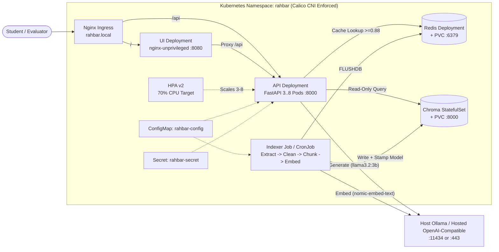

<div align="center">

# RAHBAR

### **R**eliable **A**cademic **H**andbook & **B**ylaws **A**ssistant for **R**etrieval

**Grounded University Policy Q&A on Kubernetes — Zero Hallucinated Rules, Version-Aware Citations, Honest Abstention**

[](https://github.com/nisarahmad-31/rahbar/actions/workflows/ci.yml)
[](https://github.com/nisarahmad-31/rahbar/actions/workflows/cd.yml)
[](https://www.python.org/)
[](https://fastapi.tiangolo.com/)
[](https://kubernetes.io/)
[](https://www.trychroma.com/)
[](https://redis.io/)
[](LICENSE)

[Architecture](#-architecture-overview) · [API Reference](#-api-reference) · [Quick Start](#-local-cluster-quick-start) · [Indexer Pipeline](#-running-the-indexer-job) · [Evaluation & CI](#-evaluation--ci-quality-gate) · [Docs](#-documentation-index)

</div>

---

> [!IMPORTANT]
> **Built for precision over fluency.** RAHBAR answers student and faculty questions strictly from official FAST-NUCES documents, attaches verifiable `source`, `section`, and `page` citations, prioritizes current policy revisions over superseded handbooks, and abstains cleanly when no evidence supports an answer.

## Core Design Pillars

<table>
  <tr>
    <td width="50%" valign="top">
      <h3>1. Strict Writer / Reader Separation</h3>
      <p>Vector ingestion lives inside a batch Kubernetes <code>Job</code> and weekly <code>CronJob</code> (<code>indexer/</code>). The 3+ FastAPI serving replicas (<code>api/</code>) never parse PDFs or write to Chroma at startup.</p>
    </td>
    <td width="50%" valign="top">
      <h3>2. Pinned Embedding Guardrail</h3>
      <p>The indexer stamps <code>EMBED_MODEL</code> (<code>nomic-embed-text</code>) and vector dimension into Chroma collection metadata. API pods verify the pin in <code>/readyz</code> and return <code>HTTP 503</code> (<code>0/1 READY</code>) on any mismatch.</p>
    </td>
  </tr>
  <tr>
    <td width="50%" valign="top">
      <h3>3. Temporal &amp; Relevance Filtering</h3>
      <p>Chunks carry <code>doc_version</code> and <code>superseded</code> metadata. Queries default to <code>{"superseded": false}</code> unless historical rules are explicitly asked, and scores below <code>RELEVANCE_FLOOR=0.55</code> trigger safe abstention.</p>
    </td>
    <td width="50%" valign="top">
      <h3>4. Zero-Trust Kubernetes Hardening</h3>
      <p>Every workload runs as non-root with <code>readOnlyRootFilesystem: true</code>, dropped Linux capabilities, explicit resource requests/limits, HPA (3–8 replicas), and default-deny Calico <code>NetworkPolicy</code> rules.</p>
    </td>
  </tr>
</table>

---

## Architecture Overview



### Request Lifecycle (`POST /api/ask`)

```text
Question (3-500 chars)
  └─▶ Guard & History Check ─▶ Semantic Cache (Redis cosine >= 0.88; bypassed on follow-ups)
        └─▶ Embed Query (nomic-embed-text) ─▶ Chroma Top-k (superseded=false unless requested)
              ├─▶ Relevance < 0.55 ─▶ Honest Abstention (answered_from_context=false)
              └─▶ Augment Prompt ─▶ Schema-Constrained JSON ─▶ Pydantic Validate (1 retry + safe fallback)
```

---

## API Reference

| Method | Endpoint | Purpose | Probe / Consumer |
|---|---|---|---|
| GET | `/healthz` | Process liveness check — zero external DB, cache, or LLM calls | Kubernetes `startupProbe` & `livenessProbe` |
| GET | `/readyz` | Verifies Chroma reachability, non-empty index, Redis ping, and `EMBED_MODEL` pin match (`503` if invalid) | Kubernetes `readinessProbe` |
| GET | `/metrics` | Prometheus metrics (`request_count`, retrieval/generation latency histograms, cache hits/misses, abstentions, fallbacks) | Prometheus / Observability |
| POST | `/api/ask` | Accepts `{"question": "...", "history": [...]}` and returns schema-validated `AskResponse` with citations & timings | Web UI & `eval/run_eval.py` |

---

## Local Cluster Quick Start

### Prerequisites

- **Docker Desktop** (or Docker Engine)
- **Minikube** with **Calico CNI** (so `NetworkPolicy` manifests are enforced rather than silently ignored)
- **kubectl**, **Kustomize**, and **Python 3.12+**
- **Ollama** running on your host (`OLLAMA_HOST=0.0.0.0:11434`) with models pulled:
  ```bash
  ollama pull nomic-embed-text
  ollama pull llama3.2:3b
  ```

### Step 1: Start Minikube with Calico & Addons

```bash
minikube start --driver=docker --cni=calico --memory=4096 --cpus=2
minikube addons enable metrics-server
minikube addons enable ingress
```

### Step 2: Build Images & Load Into Cluster

```bash
docker build -t rahbar-api:dev api
docker build -t rahbar-indexer:dev indexer
docker build -t rahbar-ui:dev ui

minikube image load rahbar-api:dev
minikube image load rahbar-indexer:dev
minikube image load rahbar-ui:dev
```

> [!TIP]
> On Windows hosts with limited `C:\` disk space, stream images directly into Minikube's `containerd` without creating duplicate tarball caches:
> `docker save rahbar-api:dev | docker exec -i minikube ctr -n k8s.io images import -`

### Step 3: Exact Kubernetes Apply Order

```bash
# 1. Create the isolated namespace
kubectl apply -f k8s/base/namespace.yaml

# 2. Apply ConfigMap and create Secret via CLI (never commit real secrets)
kubectl apply -f k8s/base/configmap.yaml
kubectl create secret generic rahbar-secret -n rahbar --from-literal=LLM_API_KEY="local-dev-key" --dry-run=client -o yaml | kubectl apply -f -

# 3. Deploy persistent data tier (Chroma StatefulSet + Redis Deployment/PVC)
kubectl apply -f k8s/base/chroma.yaml
kubectl apply -f k8s/base/redis.yaml

# 4. Enforce default-deny NetworkPolicies
kubectl apply -f k8s/base/networkpolicy.yaml

# 5. Apply complete dev overlay (API, UI, Ingress, HPA, CronJob, Indexer Job)
kubectl apply -k k8s/overlays/dev
```

---

## Running the Indexer Job

The corpus documents (`9` official FAST-NUCES PDFs & HTML pages) stay out of Git and are verified via SHA-256 checksums in [`corpus/MANIFEST.json`](corpus/MANIFEST.json):

```bash
# Fetch and verify the local corpus checksums
python corpus/fetch.py --verify

# Trigger the one-shot indexer Job (or launch manually from the weekly CronJob)
kubectl apply -f k8s/base/indexer-job.yaml
kubectl create job --from=cronjob/reindex manual-reindex-1 -n rahbar

# Monitor chunking, OCR, embedding, and store completion
kubectl logs -f job/manual-reindex-1 -n rahbar
```

Once the indexer finishes cleanly (exit code `0`), Chroma records `"embed_model": "nomic-embed-text"` and `"hnsw:space": "cosine"`, Redis semantic cache is flushed, and all API pods pass `/readyz` to become `1/1 READY`.

---

## Evaluation & CI Quality Gate

Run the automated 16-question golden evaluation harness against the cluster Ingress or local fixtures:

```bash
# Score the live Kubernetes deployment (requires `minikube tunnel` or hosts entry for rahbar.local)
python eval/run_eval.py --api http://rahbar.local

# Update the committed baseline after deliberate pipeline improvements
python eval/run_eval.py --api http://rahbar.local --update-baseline

# Run fast offline/CI fixture check
python eval/run_eval.py --api http://127.0.0.1:8000 --golden eval/fixtures/golden.fixture.yaml
```

### CI / CD Gate Thresholds ([`ci.yml`](.github/workflows/ci.yml) & [`cd.yml`](.github/workflows/cd.yml))

| Gate Metric | Enforced Rule | On Failure |
|---|---|---|
| **Recall@5 Regression** | Drop from [`eval/baseline.json`](eval/baseline.json) $\le 0.05$ | Exit code `1` — PR merge blocked |
| **Citation Validity** | Grounded citations matching retrieved passages $\ge 95\%$ | Exit code `1` — PR merge blocked |
| **Abstention Correctness** | Strictly $100\%$ abstention on must-abstain & out-of-scope queries | Exit code `1` — PR merge blocked |
| **Security & Manifests** | `ruff`, `mypy`, `pytest` ($\ge 60\%$ cov), `kubeconform -strict`, `trivy` (`0` fixable HIGH/CRITICAL) | Workflow fails before publish |

---

## Documentation Index

| Document | Contents |
|---|---|
| [`docs/ARCHITECTURE.md`](docs/ARCHITECTURE.md) | End-to-end component topology, security hardening, and request sequence |
| [`docs/CORPUS.md`](docs/CORPUS.md) | Inventory of all 9 FAST-NUCES sources, OCR targets, table sources, and version pairs |
| [`docs/PIPELINE.md`](docs/PIPELINE.md) | 5-stage ingestion metrics, 3-config chunking experiment, and cache threshold measurements |
| [`docs/FAILURE-ANALYSIS.md`](docs/FAILURE-ANALYSIS.md) | Systematic mitigations for failure modes A–F (grounding, injection, versioning, mismatch) |
| [`docs/ENGINEERING-NOTES.md`](docs/ENGINEERING-NOTES.md) | Concrete answers to the 7 production engineering questions with line references |
| [`docs/adr/`](docs/adr) | 4 Architecture Decision Records (`0001` Indexer Job through `0004` LLM Governance) |
| [`docs/AI-USAGE.md`](docs/AI-USAGE.md) | Transparent log of AI-assisted work, verification, and manual edits |

<details>
<summary><strong>Repository Directory Tree</strong></summary>

```text
rahbar-starter/
├── api/                    # FastAPI query service (readers, schemas, probes, Prometheus metrics)
│   ├── app/                # routes, services, retrieval, llm providers
│   ├── tests/              # injection, abstention, validation/fallback, and contract tests
│   └── Dockerfile          # python:3.12-slim, patched OS libs, non-root appuser
├── indexer/                # Batch ingestion Job (single writer: extract, clean, chunk, embed, store)
│   ├── pipeline/           # OCR (tesseract + poppler), cleaning, overlap chunking, Ollama embed
│   ├── tests/              # pipeline unit tests
│   └── Dockerfile          # python:3.12-slim + tesseract-ocr + poppler-utils, non-root indexer
├── ui/                     # Static web chat interface served by nginx-unprivileged:1.27-alpine
├── corpus/                 # sources.yaml, MANIFEST.md, MANIFEST.json, fetch.py (raw/ gitignored)
├── eval/                   # golden.yaml, run_eval.py, baseline.json, results.json, fixtures/
├── k8s/                    # base manifests + overlays/{dev,prod}/kustomization.yaml
├── docs/                   # architecture, corpus, pipeline, failure analysis, notes, ADRs, evidence/
├── scripts/                # check_submission.py
├── .github/workflows/      # ci.yml (lint, test, manifests, build, scan, e2e-eval) & cd.yml
├── LICENSE                 # MIT License
└── Makefile                # cluster, build, deploy, reindex, eval, check targets
```

</details>
