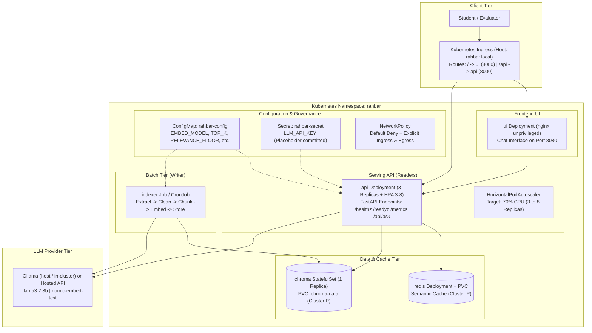

# RAHBAR: Grounded RAG on Kubernetes

[](https://github.com/nisarahmad-31/rahbar/actions/workflows/ci.yml)
[](LICENSE)
[](https://kubernetes.io)
[](https://python.org)

**RAHBAR** is a grounded question-answering system operating over official university policy documents, architected and deployed natively on Kubernetes. It is built to bridge the fundamental gap between language fluency and factual truth: it answers only from verified document context, explicitly cites its source sections, and honestly declines when a topic is not covered by the corpus.

---

## 1. Architecture Overview

RAHBAR enforces a strict separation between batch writers and serving readers around a pinned embedding model.



### Architectural Guarantees
- **One Writer, Many Readers**: Only the `indexer` Job writes to the vector database. The API replicas have strictly read-only access.
- **Embedding Pin Guardrail**: The embedding model (`EMBED_MODEL=nomic-embed-text`) is pinned in the ConfigMap. The indexer stamps this metadata into the collection. At boot and during readiness checks (`/readyz`), the API verifies that the collection's model matches its own configuration; any mismatch immediately halts traffic with an HTTP 503 error.
- **Honest Grounding & Abstention**: Output is strictly constrained to the Pydantic `Answer` schema. If retrieval relevance falls below `0.55`, the service returns `answered_from_context: false`.

---

## 2. API Reference

| GET/POST | Endpoint | Description |
|---|---|---|
| GET | /healthz | **Liveness Probe**: Confirms the FastAPI process is alive. Strictly isolated with zero database or network dependencies. |
| GET | /readyz | **Readiness Probe**: Returns HTTP 200 only if Chroma is reachable, the collection is non-empty, Redis is reachable, and the embedding pin matches. |
| GET | /metrics | **Prometheus Metrics**: Exposes request rates, retrieval/generation latencies, cache hits/misses, and abstention counters. |
| POST | /api/ask | **Grounded Query**: Accepts `{"question": "..."}` (3–500 characters) and returns a validated `AskResponse` with citations. |

---

## 3. Local Cluster Quick Start

### Prerequisites
- Docker Desktop or Docker Engine
- Minikube or Kind
- kubectl and Kustomize
- Python 3.12+

### Step 1: Start Minikube with Calico CNI
Start minikube using Calico so that NetworkPolicy manifests are strictly enforced:
```bash
minikube start --driver=docker --cni=calico --memory=6144 --cpus=4
minikube addons enable metrics-server
minikube addons enable ingress
```

### Step 2: Build and Load Docker Images
Build the three container images and load them into minikube:
```bash
docker build -t rahbar-api:dev api
docker build -t rahbar-indexer:dev indexer
docker build -t rahbar-ui:dev ui

minikube image load rahbar-api:dev
minikube image load rahbar-indexer:dev
minikube image load rahbar-ui:dev
```

### Step 3: Exact Kubernetes Apply Order
Apply manifests in the documented order to ensure dependencies resolve cleanly:
```bash
# 1. Create the dedicated namespace
kubectl apply -f k8s/base/namespace.yaml

# 2. Create the configuration and secret
kubectl apply -f k8s/base/configmap.yaml
kubectl create secret generic rahbar-secret -n rahbar --from-literal=LLM_API_KEY="your-key-here"

# 3. Deploy data tier (StatefulSet and PVCs)
kubectl apply -f k8s/base/chroma.yaml
kubectl apply -f k8s/base/redis.yaml

# 4. Deploy network isolation policies
kubectl apply -f k8s/base/networkpolicy.yaml

# 5. Apply the complete dev overlay via Kustomize
kubectl apply -k k8s/overlays/dev
```

---

## 4. How to Run the Indexer Job

The indexer is decoupled as a batch Job and does not run on API startup:

```bash
# Run one-shot indexing on the real corpus:
kubectl apply -f k8s/base/indexer-job.yaml

# Or trigger manual re-indexing on demand from the CronJob:
kubectl create job --from=cronjob/reindex manual-reindex-1 -n rahbar

# Watch indexing progress:
kubectl logs -f job/manual-reindex-1 -n rahbar
```

Once the Job completes with exit code 0, Chroma collection metadata is stamped, the semantic cache is flushed, and the API pods transition to `1/1 READY`.

---

## 5. Running Evaluations and CI Regression Gate

Score the running cluster against the 16 golden questions:
```bash
# Evaluate against cluster Ingress:
python eval/run_eval.py --api http://rahbar.local

# Evaluate locally against fixture corpus:
python eval/run_eval.py --api http://localhost:8000 --golden eval/fixtures/golden.fixture.yaml
```

The CI regression gate enforces:
1. `recall@5` falls no more than 5 percentage points below the committed baseline.
2. Citation validity is $\ge 95\%$.
3. Abstention correctness is strictly $100\%$ on must-abstain questions.

---

## 6. Repository Layout

```
rahbar/
├── api/                    # FastAPI query service (reader)
│   ├── app/                # routes, services, retrieval, providers
│   ├── tests/              # safety, validation, and contract tests
│   └── Dockerfile          # pinned, non-root user
├── indexer/                # Ingestion pipeline Job (writer)
│   ├── pipeline/           # extract, clean, chunk, embed, store
│   └── Dockerfile          # with tesseract-ocr and poppler-utils
├── ui/                     # Web chat UI (nginx unprivileged)
├── corpus/                 # fetch.py and MANIFEST.md with SHA-256 hashes
├── eval/                   # golden.yaml, run_eval.py, baseline.json, fixtures/
├── k8s/                    # base manifests and dev/prod overlays
├── docs/                   # CORPUS.md, PIPELINE.md, FAILURE-ANALYSIS.md, ADRs
└── .github/workflows/      # ci.yml (lint, test, kubeconform, trivy, e2e) and cd.yml
```
